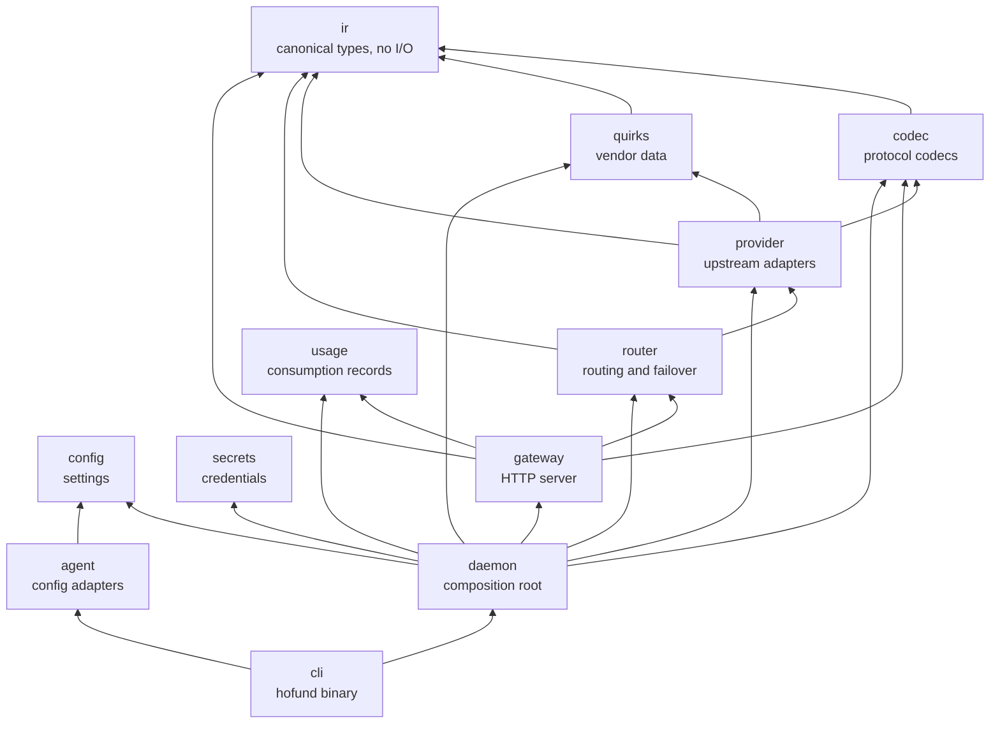

# Architecture

hofund is a local LLM gateway in the LogiBricks Heimdall series. It translates
between LLM API protocols, rewrites coding-agent configuration so any agent can
call any model, and routes each request across providers and accounts with
failover.

Hofund is an independent reimplementation inspired by magpie. The credit and
license notice live in [THIRD_PARTY_NOTICES.md](../THIRD_PARTY_NOTICES.md). Do
not use that project's name or logo as hofund branding.

The local gateway is implemented: codecs, quirk profiles, provider adapters,
ordered failover, configuration, a bearer token, usage rows, and the `hofund`
commands. Agent config rewriting and the desktop app are not. The codec field
mapping is in [codecs.md](codecs.md). The adopt-or-redesign record is in
[magpie-comparison.md](magpie-comparison.md).

Sibling repositories:

- [`logibricks-io/open-heimdall`](https://github.com/logibricks-io/open-heimdall) — the gate between your applications and intelligence
- [`logibricks-io/open-heimdall-kernel`](https://github.com/logibricks-io/open-heimdall-kernel) — a Rust gateway using hexagonal architecture

A future desktop shell may live at `apps/desktop` as a Tauri v2 application.
That directory is reserved and does not exist yet. Nothing in `crates/` may
depend on it. The desktop app may depend on the same crates as `hofund-cli`.

## Dependency direction

Arrows in the diagram point from a crate to the crates it depends on. Edges
only run downward. A crate must not depend on a crate above it on the spine.

The spine is `ir ← codec ← provider ← router ← gateway ← daemon ← cli`. Read
each arrow as "depends on". `agent` is a side branch that depends only on
`config`.

| Package | May depend on |
| --- | --- |
| `hofund-ir` | — |
| `hofund-codec` | `hofund-ir` |
| `hofund-quirks` | `hofund-ir` |
| `hofund-provider` | `hofund-codec`, `hofund-ir`, `hofund-quirks` |
| `hofund-router` | `hofund-ir`, `hofund-provider` |
| `hofund-gateway` | `hofund-codec`, `hofund-ir`, `hofund-router`, `hofund-usage` |
| `hofund-config` | — |
| `hofund-secrets` | — |
| `hofund-usage` | — |
| `hofund-agent` | `hofund-config` |
| `hofund-daemon` | `hofund-codec`, `hofund-config`, `hofund-gateway`, `hofund-provider`, `hofund-quirks`, `hofund-router`, `hofund-secrets`, `hofund-usage` |
| `hofund-cli` | `hofund-daemon`, `hofund-agent` |
| `xtask` | — |

This table is normative. `cargo test --workspace` fails when a package
manifest disagrees with it. When you add an edge, update the manifest, this
table, and `xtask/tests/workspace_invariants.rs` in the same change.

Declare internal dependencies in `[workspace.dependencies]` with an explicit
`version` equal to the workspace package version. A `workspace = true`
dependency with no version is a wildcard, and `cargo deny` rejects wildcards.

`xtask` is a development crate. No runtime crate may depend on it.

### Rules that the table is there to protect

- `agent` depends only on `config`. It must never depend on `gateway`, `router`,
  `provider`, or the daemon.
- `gateway` and `router` must not depend on `quirks`. They must not name a
  vendor or branch on vendor-specific behavior. Capability gaps and protocol
  deviations live in `quirks` data and in provider adapters.
- Protocol names (Anthropic Messages, OpenAI Chat Completions, OpenAI Responses,
  and the Generative Language API) belong in `codec`. Naming a protocol there
  is not permission to mention that vendor from `gateway` or `router`.
- The HTTP stack is axum. Only `gateway` may depend on axum, tower, or hyper.
- `usage` stays a leaf. `gateway` records one row per request. `usage` does
  not depend on `ir`; cache counters stay on the canonical usage object.
  `router` must not own usage.
- Secret material is resolved by `daemon` (via `secrets`) and passed downward.
  `provider` must not read the secret store itself.

## Crate responsibilities

| Crate | Responsibility |
| --- | --- |
| `ir` | Canonical request, response, and stream-event types. No I/O. |
| `codec` | Per-protocol encode and decode to and from the IR. Hub-and-spoke, so N protocols do not become an N-by-M matrix. |
| `quirks` | Data-driven vendor capability and quirk descriptions. |
| `provider` | `Provider` trait and upstream adapters. |
| `router` | Routing groups, strategies, and failover. |
| `gateway` | axum HTTP server and middleware pipeline. |
| `agent` | Coding-agent config adapters. A declarative description per agent; plan an edit, then apply it. The daemon passes the gateway URL and token in. |
| `config` | Typed configuration for listeners, routes, accounts, and agents. |
| `secrets` | Credential storage and resolution. |
| `usage` | Request and token usage records. |
| `daemon` | Process composition root. Wires config, secrets, and the gateway. |
| `cli` | The `hofund` binary. Delegates to the daemon and to agent adapters. |
| `xtask` | Local workspace tasks and the architecture tests. |

## What is intentionally absent

- Routing strategies other than ordered failover.
- A running process does not reload configuration.
- There is no rest timer and no process-global route counter.
- `apps/desktop`.
- Language packs. A future i18n pack is the other place, besides
  `README.<lang>.md`, where a language other than English may appear.
