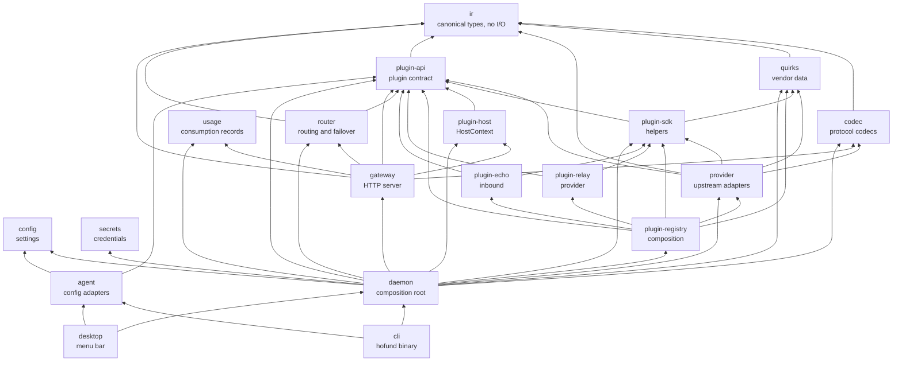

# Architecture

hofund is a local LLM gateway in the LogiBricks Heimdall series. It translates
between LLM API protocols, rewrites coding-agent configuration so any agent can
call any model, and routes each request across providers and accounts with
failover.

Hofund is an independent reimplementation inspired by magpie. The credit and
license notice live in [THIRD_PARTY_NOTICES.md](../THIRD_PARTY_NOTICES.md). Do
not use that project's name or logo as hofund branding.

The local gateway is implemented: codecs, quirk profiles, provider adapters,
ordered failover, configuration, a bearer token, usage rows, the `hofund`
commands, coding-agent adapters, and the menu-bar app. The codec field
mapping is in [codecs.md](codecs.md). The adopt-or-redesign record is in
[magpie-comparison.md](magpie-comparison.md). The accepted design for
splitting upstream providers, subscriptions, and coding-agent integrations
into plugins is [rfc/0001-microkernel-plugins.md](rfc/0001-microkernel-plugins.md)
(RFC 0001, accepted 2026-10-25). The plugin API, the SDK skeleton, and the
host constructor have landed. The rest of that RFC is still the design.
The dependency table in this document includes the edges that have landed.

Sibling repositories:

- [`logibricks-io/open-heimdall`](https://github.com/logibricks-io/open-heimdall) — the gate between your applications and intelligence
- [`logibricks-io/open-heimdall-kernel`](https://github.com/logibricks-io/open-heimdall-kernel) — a Rust gateway using hexagonal architecture

The menu-bar app lives at `apps/desktop` (Tauri v2, package `hofund-desktop`).
Nothing in `crates/` depends on it. It depends on the same crates as
`hofund-cli`: `hofund-daemon` and `hofund-agent`.

## Dependency direction

Arrows in the diagram point from a crate to the crates it depends on. Edges
only run downward. A crate must not depend on a crate above it on the spine.

The HTTP spine is `ir ← codec ← provider`, then `gateway ← daemon ← cli`.
`router` depends on `ir` and `plugin-api`, not on `provider`. Read each arrow
as "depends on". `gateway` depends on `plugin-api` for the raw body and
`PluginError`. `agent` depends on `config` and `plugin-api`. `daemon`
depends on `plugin-api` so it can adapt a provider into a router member.
`desktop` sits beside `cli` and depends on the same two crates as `cli`.
`plugin-api` depends on `ir`. `plugin-sdk` depends on `plugin-api` and
`quirks`. `plugin-host` depends on `plugin-api`. Its tests also depend on
`plugin-sdk` so the retry contract runs against the pooled client. The pooled
HTTP client lives in `plugin-host`. `plugin-registry` depends on `plugin-api`,
`plugin-sdk`, the plugin crates it composes, and `provider` and `quirks`
for the built-in factories. Those factories still call the `provider`
adapters. `provider` depends on `plugin-sdk` for SigV4 and token parsing.
`daemon` depends on `plugin-registry` and
`plugin-host` so it can call `factory` and build a `HostContext`. It depends on
`plugin-sdk` for the bounded pager used by an exact configured model-list URL.
`gateway` depends on `plugin-host` so it can build a `SurfaceHost`.
The subscription kit depends only on `plugin-host`. The agent kit also depends
on `agent` for the shared engine and `plugin-api` for descriptions. The upstream
kit depends on `plugin-api` for the factory contract. The kits are not on the
diagram. `plugin-relay` and `plugin-registry` dev-depend on `kit-upstream` for
conformance tests; the registry also dev-depends on `kit-agent` and on `agent`
for the frozen Codex equivalence oracle.

This table covers normal and build dependencies, including their target-specific forms. Dev-dependencies have a separate explicit allow-map in `xtask/tests/workspace_invariants.rs`; test-only edges below are labelled `(tests)`.

| Package | May depend on |
| --- | --- |
| `hofund-ir` | — |
| `hofund-codec` | `hofund-ir` |
| `hofund-quirks` | `hofund-ir` |
| `hofund-plugin-api` | `hofund-ir` |
| `hofund-plugin-sdk` | `hofund-plugin-api`, `hofund-quirks` |
| `hofund-plugin-fixture` | `hofund-plugin-api` |
| `hofund-plugin-echo` | `hofund-plugin-api`, `hofund-plugin-sdk` |
| `hofund-plugin-relay` | `hofund-plugin-api`, `hofund-plugin-sdk`, `hofund-kit-upstream` (tests) |
| `hofund-plugin-registry` | `hofund-plugin-api`, `hofund-plugin-sdk`, `hofund-plugin-echo`, `hofund-plugin-relay`, `hofund-provider`, `hofund-quirks`, `hofund-agent` (tests), `hofund-kit-upstream` (tests), `hofund-kit-agent` (tests) |
| `hofund-plugin-host` | `hofund-plugin-api`, `hofund-plugin-sdk` (tests) |
| `hofund-kit-upstream` | `hofund-plugin-api`, `hofund-plugin-host` |
| `hofund-kit-subscription` | `hofund-plugin-host` |
| `hofund-kit-agent` | `hofund-agent`, `hofund-plugin-api`, `hofund-plugin-host` |
| `hofund-provider` | `hofund-codec`, `hofund-ir`, `hofund-plugin-api`, `hofund-plugin-sdk`, `hofund-quirks` |
| `hofund-router` | `hofund-ir`, `hofund-plugin-api` |
| `hofund-gateway` | `hofund-codec`, `hofund-ir`, `hofund-plugin-api`, `hofund-plugin-host`, `hofund-router`, `hofund-usage` |
| `hofund-config` | — |
| `hofund-secrets` | — |
| `hofund-usage` | — |
| `hofund-agent` | `hofund-config`, `hofund-plugin-api` |
| `hofund-daemon` | `hofund-codec`, `hofund-config`, `hofund-gateway`, `hofund-plugin-api`, `hofund-plugin-host`, `hofund-plugin-registry`, `hofund-plugin-sdk`, `hofund-provider`, `hofund-quirks`, `hofund-router`, `hofund-secrets`, `hofund-usage`, `hofund-agent` (tests) |
| `hofund-cli` | `hofund-daemon`, `hofund-agent` |
| `hofund-desktop` | `hofund-daemon`, `hofund-agent` |
| `xtask` | — |

This table is normative. `cargo test --workspace` fails when a package
manifest disagrees with it. When you add an edge, update the manifest, this
table, and `xtask/tests/workspace_invariants.rs` in the same change.

Declare internal dependencies in `[workspace.dependencies]` with an explicit
`version` equal to the workspace package version. A `workspace = true`
dependency with no version is a wildcard, and `cargo deny` rejects wildcards.

`xtask` is a development crate. No runtime crate may depend on it.

### Rules that the table is there to protect

- `agent` depends on `config` and `plugin-api`. It must never depend on
  `gateway`, `router`, `provider`, or the daemon.
- A plugin does not depend on `plugin-host`. The daemon and the gateway do,
  because they construct `HostContext` and `SurfaceHost`. The three kits do,
  and they are unpublished so a plugin test can build a `HostContext`.
- `plugin-sdk` re-exports `tracing`. `plugin-api` does not depend on it.
- `gateway` and `router` must not depend on `quirks`. They must not name a
  vendor or branch on vendor-specific behavior. Capability gaps and protocol
  deviations live in `quirks` data and in provider adapters.
- Protocol names (Anthropic Messages, OpenAI Chat Completions, OpenAI Responses,
  and the Generative Language API) belong in `codec`. Naming a protocol there
  is not permission to mention that vendor from `gateway` or `router`.
- The HTTP stack is axum. Only `gateway` may depend on axum or hyper. The
  daemon may depend on `tower` for the kernel deadline and panic layer. The
  router must not depend on `tower`.
- `usage` stays a leaf. `gateway` records one row per request. `usage` does
  not depend on `ir`; cache counters stay on the canonical usage object.
  `router` must not own usage.
- Secret material is resolved by `daemon` (via `secrets`) and passed downward.
  `provider` must not read the secret store itself.

## Crate responsibilities

| Crate | Responsibility |
| --- | --- |
| `ir` | Canonical request, response, and stream-event types. No I/O. |
| `plugin-api` | Plugin traits, `PluginError`, newtypes, and `HostContext` handles. |
| `plugin-sdk` | Helpers a plugin may use. `Call` sends on the host HTTP handle. SigV4, OAuth token parsing, form bodies, and JSON page cursors live here. Re-exports `tracing` and `async_trait`. |
| `plugin-host` | The `HostContext` constructor, the pooled HTTP client, and `PlaintextFileAccountStore` (mode `0600`, plaintext until pull request H). |
| `plugin-registry` | Compile-time composition. One feature per plugin. Build fails on duplicate plugin ids, duplicate preset ids, and route-prefix conflicts. `factory` serves the built-in Chat, Responses, Messages, Generative, Vertex, and Bedrock adapters. |
| `plugin-relay` | Sample upstream plugin. The kit dependency is tests only. |
| `plugin-echo` | Sample inbound plugin. Declares `GET /hofund/echo`. |
| `kit-upstream`, `kit-subscription`, `kit-agent` | Unpublished test hosts. |
| `codec` | Per-protocol encode and decode to and from the IR. Hub-and-spoke, so N protocols do not become an N-by-M matrix. |
| `quirks` | Data-driven vendor capability and quirk descriptions. |
| `provider` | `Provider` trait and upstream adapters. |
| `router` | Ordered failover across `Member`s, and the startup `ArcSwap` snapshot. It does not name a plugin trait. |
| `gateway` | axum HTTP server and middleware pipeline. |
| `agent` | Coding-agent config adapters. A declarative description per agent; plan an edit, then apply it. The daemon passes the gateway URL and token in. |
| `config` | Typed configuration for listeners, routes, accounts, and agents. |
| `secrets` | Credential storage and resolution. |
| `usage` | Request and token usage records. |
| `daemon` | Process composition root. Wires config, secrets, and the gateway. |
| `cli` | The `hofund` binary. Delegates to the daemon and to agent adapters. |
| `desktop` | Menu-bar shell at `apps/desktop`. Renders status and calls the daemon and the agent adapters. |
| `xtask` | Local workspace tasks and the architecture tests. |

## Member cooldowns

`hofund_router::Cooldowns` is the cooldown book: explicit, thread-safe state
keyed by stable `MemberId`, not a process-global counter. The daemon membership
table owns one shared book and injects it into every published `Router`, so
cooldowns and failure ladders survive `Snapshot::store`. The default policy in
`crates/router/src/cooldown.rs` covers generic and rate-limit ladders,
`Retry-After` hints, quota and credit rests, passive observations, and timed
panic rests. Non-positive header hints are absent, and positive header hints
are capped at one hour for every failure cause. A passive observation rests a
member only when its window is exhausted; its stated reset is capped at eight
days. New events never shorten a longer active rest. The daemon records call
and stream outcomes, but counts never record success and cool only on 429 or
transport-class failures. The router only orders members, putting ready members
first and retaining the soonest cooling member as a probe.

## What is intentionally absent

- Routing strategies other than ordered failover.
- A running process does not reload configuration. The daemon publishes the
  route table as an `ArcSwap` snapshot at startup. A panic in a member
  publishes a snapshot that omits that member. In-flight requests keep the
  `Arc` they loaded. Hot reload of configuration is pull request L. The
  process does re-read the bearer token file on each request, so
  `hofund token rotate` takes effect without a restart. `GET /health` is
  unauthenticated and returns no secrets.
- There is no process-global route counter.
- Language packs. A future i18n pack is the other place, besides
  `README.<lang>.md`, where a language other than English may appear.
