# Architecture

hofund is a local LLM gateway in the LogiBricks Heimdall series. It translates
between LLM API protocols, rewrites coding-agent configuration so any agent can
call any model, and routes each request across providers and accounts with
failover.

Hofund is an independent reimplementation inspired by magpie. The credit and
license notice live in [THIRD_PARTY_NOTICES.md](../THIRD_PARTY_NOTICES.md). Do
not use that project's name or logo as hofund branding.

The local gateway is implemented: codecs, quirk profiles, provider adapters,
ordered failover, configuration, a bearer token, usage rows, the `hofund`
commands, coding-agent adapters, and the menu-bar app. The codec field
mapping is in [codecs.md](codecs.md). The adopt-or-redesign record is in
[magpie-comparison.md](magpie-comparison.md). The accepted design for
splitting upstream providers, subscriptions, and coding-agent integrations
into plugins is [rfc/0001-microkernel-plugins.md](rfc/0001-microkernel-plugins.md)
(RFC 0001, accepted 2026-10-25). The plugin API, the SDK skeleton, and the
host constructor have landed. The rest of that RFC is still the design.
The dependency table in this document includes the edges that have landed.

Sibling repositories:

- [`logibricks-io/open-heimdall`](https://github.com/logibricks-io/open-heimdall) — the gate between your applications and intelligence
- [`logibricks-io/open-heimdall-kernel`](https://github.com/logibricks-io/open-heimdall-kernel) — a Rust gateway using hexagonal architecture

Kernel library crates live at `crates/kernel/<name>`. `crates/control-proto`
and `crates/control-client` are shared by the kernel and the shells, so they
stay beside it in `crates/`. The binaries are under `apps/`: `apps/cli`
(`hofund`), `apps/hofundd` and `apps/desktop`.

The menu-bar app lives at `apps/desktop` (Tauri v2, package `hofund-desktop`).
Nothing in `crates/` depends on it. It depends on `hofund-daemon` and
`hofund-agent`.

The daemon process lives at `apps/hofundd` (package `hofund-daemon-bin`,
binary `hofundd`). It is the process composition root and the production
registry link: it constructs its own `DaemonRegistry` over `plugin-registry`,
passes it to `hofund_daemon::start_linked`, owns the async runtime, installs
the log subscriber with its `log` bridge, enables local control, and maps the
termination to the exit status. `hofund serve` runs it, and `hofund
subscription` runs `hofundd subscription`. The daemon crate keeps a
compatibility `RegistryAdapter` for the desktop until its rework; the CLI
does not link the daemon or the registry.

## Dependency direction

Arrows in the diagram point from a crate to the crates it depends on. Edges
only run downward. A crate must not depend on a crate above it on the spine.

```mermaid
flowchart BT
  ir["ir<br/>canonical types, no I/O"]
  codec["codec<br/>protocol codecs"]
  quirks["quirks<br/>vendor data"]
  provider["provider<br/>upstream adapters"]
  router["router<br/>routing and failover"]
  config["config<br/>settings"]
  controlClient["control-client<br/>typed control transports"]
  controlProto["control-proto<br/>wire DTOs and events"]
  controlClient --> controlProto
  daemon --> controlProto
  gateway --> controlProto
  secrets["secrets<br/>credentials"]
  usage["usage<br/>consumption records"]
  agent["agent<br/>config adapters"]
  pluginApi["plugin-api<br/>plugin contract"]
  pluginSdk["plugin-sdk<br/>helpers"]
  pluginHost["plugin-host<br/>HostContext"]
  pluginRegistry["plugin-registry<br/>composition"]
  pluginRelay["plugin-relay<br/>provider"]
  pluginEcho["plugin-echo<br/>inbound"]
  pluginOllama["plugin-ollama<br/>inbound"]
  pluginMuse["plugin-muse<br/>inbound"]
  pluginCodexCatalog["plugin-codex-catalog<br/>inbound"]
  pluginRetrieval["plugin-retrieval<br/>inbound"]
  pluginCodex["plugin-subscription-codex<br/>subscription"]
  pluginClaude["plugin-subscription-claude<br/>subscription"]
  pluginCopilot["plugin-subscription-copilot<br/>subscription"]
  pluginGemini["plugin-subscription-gemini<br/>subscription"]
  gateway["gateway<br/>HTTP server"]
  daemon["daemon<br/>daemon library"]
  hofundd["hofundd<br/>process composition root"]
  cli["cli<br/>hofund binary"]
  desktop["desktop<br/>menu bar"]

  codec --> ir
  quirks --> ir
  provider --> codec
  provider --> ir
  provider --> quirks
  provider --> pluginApi
  provider --> pluginSdk
  pluginApi --> ir
  pluginSdk --> codec
  pluginSdk --> ir
  pluginSdk --> pluginApi
  pluginSdk --> quirks
  pluginHost --> pluginApi
  pluginRegistry --> pluginApi
  pluginRegistry --> pluginSdk
  pluginRegistry --> pluginRelay
  pluginRegistry --> pluginEcho
  pluginRegistry --> pluginOllama
  pluginRegistry --> pluginMuse
  pluginRegistry --> pluginCodexCatalog
  pluginRegistry --> pluginRetrieval
  pluginRegistry --> pluginCodex
  pluginRegistry --> pluginClaude
  pluginRegistry --> pluginCopilot
  pluginRegistry --> pluginGemini
  pluginRegistry --> provider
  pluginRegistry --> quirks
  pluginRelay --> pluginApi
  pluginRelay --> pluginSdk
  pluginEcho --> pluginApi
  pluginEcho --> pluginSdk
  pluginOllama --> pluginApi
  pluginOllama --> pluginSdk
  pluginMuse --> pluginApi
  pluginMuse --> pluginSdk
  pluginCodexCatalog --> pluginApi
  pluginCodexCatalog --> pluginSdk
  pluginRetrieval --> pluginApi
  pluginRetrieval --> pluginSdk
  pluginCodex --> pluginApi
  pluginCodex --> pluginSdk
  pluginClaude --> pluginApi
  pluginClaude --> pluginSdk
  pluginCopilot --> pluginApi
  pluginCopilot --> pluginSdk
  pluginGemini --> pluginApi
  pluginGemini --> pluginSdk
  router --> pluginApi
  router --> controlProto
  router --> ir
  gateway --> router
  gateway --> codec
  gateway --> ir
  gateway --> usage
  gateway --> pluginApi
  gateway --> pluginHost
  daemon --> gateway
  daemon --> config
  daemon --> secrets
  daemon --> provider
  daemon --> codec
  daemon --> quirks
  daemon --> router
  daemon --> pluginApi
  daemon --> pluginHost
  daemon --> pluginRegistry
  daemon --> pluginSdk
  daemon --> usage
  daemon --> agent
  agent --> config
  agent --> pluginApi
  hofundd --> daemon
  hofundd --> pluginApi
  hofundd --> pluginRegistry
  cli --> daemon
  cli --> agent
  desktop --> daemon
  desktop --> agent
```

The HTTP spine is `ir ← codec ← provider`, then `gateway ← daemon ← cli`.
`router` depends on `ir`, `plugin-api`, and `control-proto` (the quota store keeps and reports the wire quota cards), not on `provider`. Read each arrow
as "depends on". `gateway` depends on `plugin-api` for the raw body and
`PluginError`. `agent` depends on `config` and `plugin-api`. `daemon`
depends on `plugin-api` so it can adapt a provider into a router member.
`desktop` sits beside `cli` and depends on `daemon` and `agent`. `cli`
reaches the daemon through `control-client` and reads its config and token
through `config` and `secrets`, and runs `hofundd` for `serve`,
`subscription`, and one-shot operations. It has no `daemon` edge; an
`xtask` test checks with `cargo metadata` that only `hofundd`, the daemon
crate, and the desktop link `plugin-registry`.
`plugin-api` depends on `ir`. `plugin-sdk` depends on `codec`, `ir`,
`plugin-api`, and `quirks`. It uses `codec` for the Chat and Responses
transport and `ir` to fold a stream into one response.
`plugin-host` depends on `plugin-api`. Its tests also depend on
`plugin-sdk` so the retry contract runs against the pooled client. The pooled
HTTP client lives in `plugin-host`. `plugin-registry` depends on `plugin-api`,
`plugin-sdk`, the plugin crates it composes, and `provider` and `quirks`
for the built-in factories. Those factories still call the `provider`
adapters. `provider` depends on `plugin-sdk` for SigV4 and token parsing.
`daemon` depends on `plugin-registry` and
`plugin-host` so it can call `factory` and build a `HostContext`. It depends on
`plugin-sdk` for the bounded pager used by an exact configured model-list URL.
It depends on `agent` so the control plane can plan, connect, and disconnect
agent configs and refresh them after a token rotation.
`gateway` depends on `plugin-host` so it can build a `SurfaceHost`. Each
surface request gets `SurfaceHost::gateway()`, which runs the gateway's codec
routes and model lists in process (S0). A surface that translates a client's
API calls a codec route there instead of opening a socket. The call presents
the gateway token, whatever credential the surface set, and cannot reach a
surface route, so surfaces cannot call each other.
A surface that relays a client's request, with the client's own credential, to
the service the client was built for uses `SurfaceHost::http()` (S6a): the
kernel's pooled client, with the daemon's connect and idle-read limits. The
gateway token may come in `x-api-key` beside the client's own bearer, because
one matching secret is enough; the surface drops the gateway token before it
relays. A gateway built without `Gateway::with_surface_http` gives surfaces no
handle.
The subscription kit depends only on `plugin-host`. The agent kit also depends
on `agent` for the shared engine and `plugin-api` for descriptions. The upstream
kit depends on `plugin-api` for the factory contract. The kits are not on the
diagram. `plugin-relay` and `plugin-registry` dev-depend on `kit-upstream` for
conformance tests, and the subscription plugins dev-depend on
`kit-subscription`; the registry also dev-depends on `kit-agent` and on `agent`
for the frozen Codex, Claude Code, Gemini CLI, and OpenCode equivalence oracles.
All four agents ship as `plugins/agents/<id>/agent.toml`; no const-backed agent
remains.

This table covers normal and build dependencies, including their target-specific forms. Dev-dependencies have a separate explicit allow-map in `xtask/tests/workspace_invariants.rs`; test-only edges below are labelled `(tests)`.

| Package | May depend on |
| --- | --- |
| `hofund-ir` | — |
| `hofund-codec` | `hofund-ir` |
| `hofund-quirks` | `hofund-ir` |
| `hofund-plugin-api` | `hofund-ir` |
| `hofund-plugin-sdk` | `hofund-codec`, `hofund-ir`, `hofund-plugin-api`, `hofund-quirks` |
| `hofund-plugin-fixture` | `hofund-plugin-api` |
| `hofund-plugin-echo` | `hofund-plugin-api`, `hofund-plugin-sdk` |
| `hofund-plugin-codex-catalog` | `hofund-plugin-api`, `hofund-plugin-sdk` |
| `hofund-plugin-muse` | `hofund-plugin-api`, `hofund-plugin-sdk` |
| `hofund-plugin-ollama` | `hofund-plugin-api`, `hofund-plugin-sdk` |
| `hofund-plugin-relay` | `hofund-plugin-api`, `hofund-plugin-sdk`, `hofund-kit-upstream` (tests) |
| `hofund-plugin-retrieval` | `hofund-plugin-api`, `hofund-plugin-sdk` |
| `hofund-plugin-registry` | `hofund-plugin-api`, `hofund-plugin-sdk`, `hofund-plugin-codex-catalog`, `hofund-plugin-echo`, `hofund-plugin-muse`, `hofund-plugin-ollama`, `hofund-plugin-relay`, `hofund-plugin-retrieval`, `hofund-plugin-subscription-claude`, `hofund-plugin-subscription-codex`, `hofund-plugin-subscription-copilot`, `hofund-plugin-subscription-gemini`, `hofund-provider`, `hofund-quirks`, `hofund-agent` (tests), `hofund-kit-upstream` (tests), `hofund-kit-agent` (tests) |
| `hofund-plugin-subscription-claude` | `hofund-plugin-api`, `hofund-plugin-sdk`, `hofund-kit-subscription` (tests) |
| `hofund-plugin-subscription-codex` | `hofund-plugin-api`, `hofund-plugin-sdk`, `hofund-kit-subscription` (tests) |
| `hofund-plugin-subscription-copilot` | `hofund-plugin-api`, `hofund-plugin-sdk`, `hofund-kit-subscription` (tests) |
| `hofund-plugin-subscription-gemini` | `hofund-plugin-api`, `hofund-plugin-sdk`, `hofund-kit-subscription` (tests) |
| `hofund-plugin-host` | `hofund-plugin-api`, `hofund-plugin-sdk` (tests) |
| `hofund-kit-upstream` | `hofund-plugin-api`, `hofund-plugin-host` |
| `hofund-kit-subscription` | `hofund-plugin-host` |
| `hofund-kit-agent` | `hofund-agent`, `hofund-plugin-api`, `hofund-plugin-host` |
| `hofund-provider` | `hofund-codec`, `hofund-ir`, `hofund-plugin-api`, `hofund-plugin-sdk`, `hofund-quirks` |
| `hofund-router` | `hofund-control-proto`, `hofund-ir`, `hofund-plugin-api` |
| `hofund-gateway` | `hofund-codec`, `hofund-control-proto`, `hofund-ir`, `hofund-plugin-api`, `hofund-plugin-host`, `hofund-router`, `hofund-usage` |
| `hofund-config` | — |
| `hofund-control-client` | `hofund-control-proto` |
| `hofund-control-proto` | — |
| `hofund-secrets` | — |
| `hofund-usage` | — |
| `hofund-agent` | `hofund-config`, `hofund-plugin-api` |
| `hofund-daemon` | `hofund-codec`, `hofund-config`, `hofund-control-proto`, `hofund-gateway`, `hofund-plugin-api`, `hofund-plugin-host`, `hofund-plugin-registry` (tests also enable `test-fixtures`), `hofund-plugin-sdk`, `hofund-provider`, `hofund-quirks`, `hofund-router`, `hofund-secrets`, `hofund-usage`, `hofund-agent` |
| `hofund-daemon-bin` | `hofund-daemon`, `hofund-plugin-api`, `hofund-plugin-registry` |
| `hofund-cli` | `hofund-config`, `hofund-control-client`, `hofund-daemon`, `hofund-secrets` |
| `hofund-desktop` | `hofund-daemon`, `hofund-agent` |
| `xtask` | — |

This table is normative. `cargo test --workspace` fails when a package
manifest disagrees with it. When you add an edge, update the manifest, this
table, and `xtask/tests/workspace_invariants.rs` in the same change.

Declare internal dependencies in `[workspace.dependencies]` with an explicit
`version` equal to the workspace package version. A `workspace = true`
dependency with no version is a wildcard, and `cargo deny` rejects wildcards.

`xtask` is a development crate. No runtime crate may depend on it.
The `control-client` and gateway `control-proto` edges landed in L3; the
`hofundd` composition-root edges arrive in L7, as ordered by
[the control-plane plan](plugins/control-plane.md).

### Rules that the table is there to protect

- `agent` depends on `config` and `plugin-api`. It must never depend on
  `gateway`, `router`, `provider`, or the daemon.
- A plugin does not depend on `plugin-host`. The daemon and the gateway do,
  because they construct `HostContext` and `SurfaceHost`. The three kits do,
  and they are unpublished so a plugin test can build a `HostContext`.
- `plugin-sdk` re-exports `tracing`. `plugin-api` does not depend on it.
- `gateway` and `router` must not depend on `quirks`. They must not name a
  vendor or branch on vendor-specific behavior. Capability gaps and protocol
  deviations live in `quirks` data and in provider adapters.
- The vendor-name scan (`kernel_crates_do_not_name_vendors` in
  `xtask/tests/workspace_invariants.rs`) covers every crate under `crates/`
  and `crates/kernel/` except those on `VENDOR_SCAN_PENDING`, which still
  hold vendor code. Shells under `apps/` (the `hofund` CLI, `hofundd`, the
  desktop) are not scanned. That
  list names whole crates, never lines, and a crate that stops naming a vendor
  must leave it. Preset rows live only in plugin fragments; a kernel crate may
  not ship a `presets.toml`.
- Protocol names (Anthropic Messages, OpenAI Chat Completions, OpenAI Responses,
  and the Generative Language API) belong in `codec`. Naming a protocol there
  is not permission to mention that vendor from `gateway` or `router`.
- Only `gateway` may depend on axum. `gateway` and `control-client` may depend
  on hyper, http, http-body-util, and hyper-util for their HTTP edges. The
  daemon may depend on `tower` for the kernel deadline and panic layer. The
  router must not depend on `tower`.
- `usage` stays a leaf. `gateway` records one row per request. `usage` does
  not depend on `ir`; cache counters stay on the canonical usage object.
  `router` must not own usage.
- Secret material is resolved by `daemon` (via `secrets`) and passed downward.
  `provider` must not read the secret store itself.

## Crate responsibilities

| Crate | Responsibility |
| --- | --- |
| `ir` | Canonical request, response, and stream-event types. No I/O. |
| `plugin-api` | Plugin traits, `PluginError`, newtypes, and `HostContext` handles. |
| `plugin-sdk` | Helpers a plugin may use. `Call` sends on the host HTTP handle. SigV4, OAuth token parsing, form bodies, and JSON page cursors live here. Re-exports `tracing` and `async_trait`. |
| `plugin-host` | The `HostContext` constructor, the pooled HTTP client, and `PlaintextFileAccountStore` (mode `0600`, plaintext until pull request H). |
| `plugin-registry` | Compile-time composition. One feature per plugin. Build fails on duplicate plugin ids, duplicate preset ids, and route-prefix conflicts. `factory` serves the built-in Chat, Responses, Messages, and Generative adapters. |
| `plugin-relay` | Sample upstream plugin. The kit dependency is tests only. |
| `plugin-echo` | Sample inbound plugin. Declares `GET /hofund/echo`. |
| `plugin-ollama` | The Ollama API (`/api/version`, `/api/tags`, `/api/show`, `/api/chat`, `/api/generate`) for clients that take an Ollama server. Lists the gateway's models and runs chats on its Chat Completions route in process. |
| `plugin-muse` | Muse Code's model list (`GET /muse-code/models`): the gateway's models with the `metadata["muse-code"]` Muse needs to show them. Read in process. |
| `plugin-codex-catalog` | Codex's model catalog (`GET /v1/codex/models`, its `model_catalog_url`): the gateway's models as `models.json` entries, cut to the 1 MiB Codex reads. Read in process. Also Codex's ChatGPT backend (`GET`/`POST /backend-api/codex`): the backend's model list plus the gateway's, hofund models served in process as `/v1/responses` (and compacted there, on Codex's `compaction_trigger`, into a summary item), Codex's own models' input put right for the backend, and everything else relayed on the kernel pool with the caller's own sign-in. |
| `plugin-retrieval` | Embeddings, rerank, and speech to text (`POST /v1/embeddings`, `POST /v1/rerank`, `POST /v1/audio/transcriptions`, `POST /v1/audio/translations`): the JSON body or multipart form is forwarded unchanged but for the model name to the first provider of the model that serves the path, and the answer comes back as sent, with its content type. |
| `plugin-subscription-codex` | ChatGPT (Codex) subscription: browser sign-in, token refresh, and the Responses upstream. |
| `plugin-subscription-claude` | Claude Code subscription: sign-in and refresh by running the `claude` command line in a private config directory. |
| `plugin-subscription-copilot` | GitHub Copilot subscription, on github.com or a `<name>.ghe.com` enterprise host: device sign-in, session tokens, quota, the account model list, and per-model Chat Completions, Responses and Messages routing. |
| `plugin-subscription-gemini` | Gemini CLI (Code Assist) subscription: browser sign-in, Code Assist project setup, and token refresh. |
| `kit-upstream`, `kit-subscription`, `kit-agent` | Unpublished test hosts. |
| `codec` | Per-protocol encode and decode to and from the IR. Hub-and-spoke, so N protocols do not become an N-by-M matrix. |
| `quirks` | Data-driven vendor capability and quirk descriptions. |
| `provider` | `Provider` trait and upstream adapters. |
| `router` | Ordered failover across `Member`s, and the startup `ArcSwap` snapshot. It does not name a plugin trait. |
| `gateway` | axum HTTP server and middleware pipeline. |
| `agent` | Coding-agent config adapters. A declarative description per agent; plan an edit, then apply it. The daemon passes the gateway URL and token in. |
| `config` | Typed configuration for listeners, routes, accounts, and agents. |
| `control-client` | Typed control calls and ordered discovery over TCP and Unix local IPC. Re-exports the proto for UI callers. |
| `control-proto` | Versioned serde DTOs, events, error envelope, and wire version. No HTTP, Tokio, daemon, router, provider, or plugin-api dependency. |
| `secrets` | Credential storage and resolution. |
| `usage` | Request and token usage records. |
| `daemon` | The daemon library. Wires config, secrets, the gateway, and the control plane around an injected `DaemonRegistry`. |
| `hofundd` | The `hofundd` binary and process composition root. Links the plugin registry, owns the runtime, logging, signals, and drain. |
| `cli` | The `hofund` binary at `apps/cli`, a shell like the desktop. `hofund serve` runs `hofundd`. Runtime commands go to the running daemon over the control plane, or to one-shot `hofundd` when none runs. |
| `desktop` | Menu-bar shell at `apps/desktop`. Renders status and calls the daemon and the agent adapters. |
| `xtask` | Local workspace tasks and the architecture tests. |

## Routing strategies and measurements

`hofund_router::strategy` owns the pure ordering functions and explicit
per-route rotation, weighted-round, and speed-probe state. The daemon implements
`Measurements` by reading the shared quota store, successful usage rows, and
cached model catalogs. Token use has a one-hour half-life. Streamed replies
record first-content latency beside whole-answer latency; speed uses a
20-minute half-life and becomes unknown after an hour. Prices remain catalog
data and are converted from millionths of a dollar to dollars per million
tokens when a route is weighed. No process-global measurement or routing
counter exists, and the router does not own the usage ledger. Each strategy
declares the measurements it reads (`Needs`); allowances are always filled, and
the ledger is read only for usage or speed, over the last day or hour through
the `created_unix` index.

Smart uses 90% and 98% allowance tiers, hourly renewal and lapse comparisons,
and prepaid balances ranked only inside one provider and unit. Usage and pace
break ties with decayed tokens; pace also uses 10% remaining-per-hour bands.
Fast estimates a 200-token reply and probes unmeasured members every fifth
eligible request. Cheap compares input-plus-output price, then cache-read
price, with unpriced members last. Ready members retain strategy order before
the single cooling probe.

## Member cooldowns

`hofund_router::Cooldowns` is the cooldown book: explicit, thread-safe state
keyed by stable `MemberId`, not a process-global counter. The daemon membership
table owns one shared book and injects it into every published `Router`, so
cooldowns and failure ladders survive `Snapshot::store`. The default policy in
`crates/kernel/router/src/cooldown.rs` covers generic and rate-limit ladders,
`Retry-After` hints, quota and credit rests, passive observations, and timed
panic rests. Generic and rate-limit failures do not climb while their own rest
is active. An API-key credit refusal climbs 30 minutes, 2 hours, 8 hours,
24 hours, 3 days, and a repeating 7-day rung after each ended rest; success and
manual removal restart it. Retry hints and soon/smaller-request wording stay
flat at 30 minutes, while a named reset wins. Windowed subscription accounts
use body reset, header reset, full-window reset, a retry hint longer than five
hours, then five hours; a later renewed-window observation lifts the rest.
Other subscription accounts stay at 30 minutes. Named credit resets cap at 35
days, generic/rate/quota header hints cap at one hour, and passive window resets
cap at eight days. New events never shorten a longer active rest.

Only API-key credit-ladder rests persist. The daemon writes their wall-clock
deadlines and rungs to `rests.json` beside the configuration through a
same-directory temporary file and rename, only when the snapshot changes. It
restores configured members at startup, keeps ended rungs for 35 days, ignores
corrupt files without failing startup, and lets in-process state win. Rate,
quota, generic, observation, flat-credit, and subscription rests remain
in-memory. The daemon records call and stream outcomes, but counts never record
success and cool only on 429 or transport-class failures.

A failure that says no connection was made (a connect error, or a 502,
transport, or I/O error naming a refused dial or failed lookup) does not rest
the member when this computer has no network
(`crates/kernel/daemon/src/offline.rs`). The network is only checked when no
upstream answered in the last 15 seconds: the check needs a route out with a
usable local address, then dials up to three other providers (not the failing
one, and not hosts on this computer or its local network) for 2 seconds each.
No connection means offline; with nothing else to dial, a route out counts as
online. The answer is kept for 5 seconds and one request asks at a time.
Offline, the next member is still asked, and the last member's failure goes to
the client, but nobody rests. The router only orders
members, putting ready members first and retaining the soonest cooling member
as a probe.

## Failover decisions

`crates/kernel/router/src/decision.rs` decides, before any reply byte, whether
the next member is asked. The order is fixed:

1. A context overflow (413, or a body naming the context or token limit) is
   never a plain failover. Members of the same provider and wire model are
   skipped, and so are members whose known context window is at or below the
   estimated input tokens (a 413 only skips the same model). Members with an
   unknown window are asked. If none is left, the overflow goes back to the
   client in its own protocol. An overflow never rests the member. A member's
   window is the context size its provider's model list gives the hop's model
   (matched without regard to case); a model the list does not size has an
   unknown window.
2. The statuses in `failover.statuses` fail over. The default is 401, 402, 403,
   404, 408, 429, and 500 to 599.
3. Some replies fail over by their body words even with a status not in
   `failover.statuses`: a retired model on any status, an edge block on any
   error status, a credit reply on any 4xx, and quota, unserved-model,
   refusal, request-shape, unsupported-parameter, wrong-endpoint, or region
   wording on a 400 or 422. Narrowing `statuses` does not turn these off.
   Escaped (`\u`) JSON text is read decoded as well.
4. A response-protection refusal skips every member of the same provider, and
   a request-shape refusal asks the next member, whatever the status list
   says. Neither rests the member, nor does a refusal of the prompt.
5. A 400, 413, 422, or 5xx with no clear cause, on a member whose known window
   is below the estimated input times 1.2, is told to the client as a prompt
   too long, and the overflow rule above applies.

Connect, timeout, and interrupted-body errors follow `failover.connect_errors`.

## What is intentionally absent

- A running process does not reload configuration. The daemon publishes the
  route table as an `ArcSwap` snapshot at startup. A panic in a member
  publishes a snapshot that omits that member. In-flight requests keep the
  `Arc` they loaded. Hot reload of configuration is pull request L. The
  process does re-read the bearer token file on each request, so
  `hofund token rotate` takes effect without a restart. `GET /health` is
  unauthenticated and returns no secrets.
- There is no process-global route counter.
- Language packs. A future i18n pack is the other place, besides
  `README.<lang>.md`, where a language other than English may appear.
